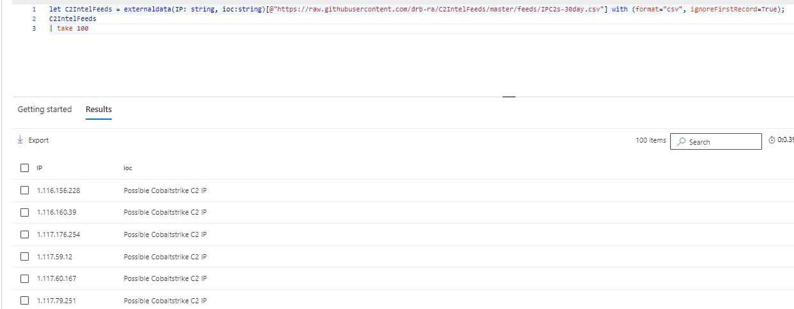

# <div align="center">Open-Source Threat Intelligence Feeds</div>

<div align="center">

[](https://github.com/Bert-JanP/Open-Source-Threat-Intel-Feeds/stargazers)
[](./LICENSE)
[](./ThreatIntelFeeds.csv)
[](https://twitter.com/intent/tweet?text=Open%20Source%20Threat%20Intel%20Feeds%20for%20threat%20hunting&url=https://github.com/Bert-JanP/Open-Source-Threat-Intel-Feeds)

**A curated, community-maintained catalog of public threat intelligence and IOC feeds.**

</div>

Browse the sources directly, import the catalog into a threat hunting workflow, or use it to enrich detections in your SIEM and EDR platform.

## Table of contents

- [Quick start](#quick-start)
- [Catalog at a glance](#catalog-at-a-glance)
- [Use feeds in KQL](#use-feeds-in-kql)
- [Contribute](#contribute)
- [Feed sources](#feed-sources)

## Quick start

There are three ways to use this repository:

| Goal | Resource |
| --- | --- |
| Browse every source | [ThreatIntelFeeds.csv](./ThreatIntelFeeds.csv) |
| Find a provider or feed | [Feed sources](#feed-sources) at the bottom of this README |
| Import feeds into Microsoft Sentinel or Defender XDR | Follow the [KQL example](#use-feeds-in-kql) |

The CSV is semicolon-delimited and uses this schema:

```text
Vendor;Description;Category;Url;FeedStatus
```

> [!IMPORTANT]
> Public availability does not automatically mean a feed can be used for every purpose. Feed-specific terms, retention, attribution, redistribution, and commercial-use conditions must be checked before production use. The catalog is provided as-is.

## Catalog at a glance

The catalog currently contains **165 feed entries** across the following indicator categories:

| Category | Count |
| --- | --- |
| DNS | 22 |
| IP | 82 |
| MD5 | 12 |
| SHA1 | 5 |
| SHA256 | 10 |
| SSL | 1 |
| URL | 25 |
| CVEID | 5 |
| RANSOMWARELEAK | 1 |
| JA3 | 1 |
| NamePipe | 1 |

Supported categories are: `SSL`, `IP`, `DNS`, `URL`, `MD5`, `SHA1`, `SHA256`, `CVEID`, `RANSOMWARELEAK`, `JA3`, and `NamePipe`.

## Use feeds in KQL

Microsoft Sentinel and Microsoft 365 Defender support the [`externaldata` operator](https://learn.microsoft.com/en-us/azure/data-explorer/kusto/query/externaldata-operator). Use it to turn a public CSV or TXT feed into a table that can be joined against network, authentication, file, or vulnerability telemetry.

```kusto
let C2IntelFeeds = externaldata(IP:string, IOC:string)
[
    @"https://raw.githubusercontent.com/drb-ra/C2IntelFeeds/master/feeds/IPC2s-30day.csv"
]
with (format="csv", ignoreFirstRecord=true);
C2IntelFeeds
| take 100
```

The following example compares remote IP telemetry with a C2 feed and adds geolocation context:

```kusto
let C2IntelFeeds = externaldata(IP:string, IOC:string)
[
    @"https://raw.githubusercontent.com/drb-ra/C2IntelFeeds/master/feeds/IPC2s-30day.csv"
]
with (format="csv", ignoreFirstRecord=true);

DeviceNetworkEvents
| where RemoteIP in (C2IntelFeeds | project IP)
| join kind=inner C2IntelFeeds on $left.RemoteIP == $right.IP
| extend GeoIPInfo = geo_info_from_ip_address(RemoteIP)
| extend country = tostring(parse_json(GeoIPInfo).country),
         state = tostring(parse_json(GeoIPInfo).state),
         city = tostring(parse_json(GeoIPInfo).city)
| project Timestamp, DeviceName, RemoteIP, RemotePort, RemoteUrl, IOC
```



For more ready-to-run examples, see the [KQL Hunting Queries and Detection Rules](https://github.com/Bert-JanP/Hunting-Queries-Detection-Rules/tree/main/Threat%20Hunting).

## Contribute

Community contributions keep this catalog useful and current.

1. Add or update the source under the matching provider in the [feed source list](#feed-sources).
2. Add the vendor, description, category, URL, and status to [ThreatIntelFeeds.csv](./ThreatIntelFeeds.csv).
3. Use a category from `valid_categories` in [Validator.py](./Scripts/Validator.py).
4. Prefer sources that are directly accessible without accounts or API keys.
5. Run the CSV validator from the `Scripts` directory:

   ```powershell
   cd Scripts
   python Validator.py
   ```

6. Refresh the statistics table from the `Scripts` directory when categories change:

   ```powershell
   cd Scripts
   python GenerateTableStatistics.py
   ```

## Feed sources


# Abuse.ch
- https://sslbl.abuse.ch/blacklist/sslblacklist.csv
- https://sslbl.abuse.ch/blacklist/sslipblacklist.csv
- https://sslbl.abuse.ch/blacklist/sslipblacklist.txt
- https://sslbl.abuse.ch/blacklist/sslipblacklist_aggressive.csv
- https://sslbl.abuse.ch/blacklist/sslipblacklist_aggressive.txt
- https://threatfox.abuse.ch/downloads/hostfile/
- https://feodotracker.abuse.ch/downloads/ipblocklist.txt
- https://feodotracker.abuse.ch/blocklist/
- https://bazaar.abuse.ch/export/txt/md5/recent/
- https://threatfox.abuse.ch/export/csv/md5/recent/
- https://bazaar.abuse.ch/export/txt/sha1/recent/
- https://bazaar.abuse.ch/export/txt/sha256/recent/
- https://threatfox.abuse.ch/export/csv/sha256/recent/
- https://urlhaus.abuse.ch/downloads/csv_recent/
- https://sslbl.abuse.ch/blacklist/ja3_fingerprints.csv

Terms of Service: https://sslbl.abuse.ch/blacklist/, https://feodotracker.abuse.ch/blocklist/

# Blocklist.de
- https://lists.blocklist.de/lists/all.txt
- https://lists.blocklist.de/lists/ssh.txt
- https://lists.blocklist.de/lists/mail.txt
- https://lists.blocklist.de/lists/apache.txt
- https://lists.blocklist.de/lists/imap.txt
- https://lists.blocklist.de/lists/bots.txt
- https://lists.blocklist.de/lists/bruteforcelogin.txt
- https://lists.blocklist.de/lists/strongips.txt
- https://lists.blocklist.de/lists/ftp.txt

Terms of Service: https://www.blocklist.de/en/index.html

# IPSum
- https://raw.githubusercontent.com/stamparm/ipsum/master/levels/1.txt
- https://raw.githubusercontent.com/stamparm/ipsum/master/levels/2.txt
- https://raw.githubusercontent.com/stamparm/ipsum/master/levels/3.txt
- https://raw.githubusercontent.com/stamparm/ipsum/master/levels/4.txt
- https://raw.githubusercontent.com/stamparm/ipsum/master/levels/5.txt
- https://raw.githubusercontent.com/stamparm/ipsum/master/levels/6.txt
- https://raw.githubusercontent.com/stamparm/ipsum/master/levels/7.txt
- https://raw.githubusercontent.com/stamparm/ipsum/master/levels/8.txt

# C2IntelFeeds
- https://github.com/drb-ra/C2IntelFeeds/blob/master/feeds/IPC2s-30day.csv
- https://github.com/drb-ra/C2IntelFeeds/blob/master/feeds/domainC2s-30day-filter-abused.csv
- https://github.com/drb-ra/C2IntelFeeds/blob/master/feeds/domainC2swithURL-30day-filter-abused.csv
- https://github.com/drb-ra/C2IntelFeeds/blob/master/feeds/domainC2swithURL-filter-abused.csv
- https://github.com/drb-ra/C2IntelFeeds/blob/master/feeds/domainC2swithURLwithIP-30day-filter-abused.csv
- https://github.com/drb-ra/C2IntelFeeds/blob/master/feeds/domainC2s.csv
- https://github.com/drb-ra/C2IntelFeeds/blob/master/feeds/unverified/IPC2s.csv

# Montysecurity Feeds
- https://github.com/montysecurity/C2-Tracker/tree/main/data
- https://github.com/montysecurity/C2-Tracker/blob/main/data/Brute%20Ratel%20C4%20IPs.txt
- https://github.com/montysecurity/C2-Tracker/blob/main/data/Cobalt%20Strike%20C2%20IPs.txt
- https://github.com/montysecurity/C2-Tracker/blob/main/data/Posh%20C2%20IPs.txt
- https://github.com/montysecurity/C2-Tracker/blob/main/data/Sliver%20C2%20IPs.txt
- https://github.com/montysecurity/C2-Tracker/blob/main/data/Metasploit%20Framework%20C2%20IPs.txt
- https://github.com/montysecurity/C2-Tracker/blob/main/data/Havoc%20C2%20IPs.txt
- https://raw.githubusercontent.com/montysecurity/C2-Tracker/main/data/BurpSuite%20IPs.txt
- https://raw.githubusercontent.com/montysecurity/C2-Tracker/main/data/Deimos%20C2%20IPs.txt
- https://raw.githubusercontent.com/montysecurity/C2-Tracker/main/data/GoPhish%20IPs.txt
- https://raw.githubusercontent.com/montysecurity/C2-Tracker/main/data/Gotham%20Stealer%20IPs.txt
- https://raw.githubusercontent.com/montysecurity/C2-Tracker/main/data/Hachcat%20Cracking%20Tool%20IPs.txt
- https://raw.githubusercontent.com/montysecurity/C2-Tracker/main/data/Metasploit%20Framework%20C2%20IPs.txt
- https://raw.githubusercontent.com/montysecurity/C2-Tracker/main/data/Mythic%20C2%20IPs.txt
- https://raw.githubusercontent.com/montysecurity/C2-Tracker/main/data/NimPlant%20C2%20IPs.txt
- https://raw.githubusercontent.com/montysecurity/C2-Tracker/main/data/PANDA%20C2%20IPs.txt
- https://raw.githubusercontent.com/montysecurity/C2-Tracker/main/data/Posh%20C2%20IPs.txt
- https://raw.githubusercontent.com/montysecurity/C2-Tracker/main/data/PowerSploit%20IPs.txt
- https://raw.githubusercontent.com/montysecurity/C2-Tracker/main/data/XMRig%20Monero%20Cryptominer%20IPs.txt
- https://raw.githubusercontent.com/montysecurity/C2-Tracker/main/data/all.txt


# Carbon Black
- https://github.com/carbonblack/active_c2_ioc_public/blob/main/cobaltstrike/actor-specific/cobaltstrike_luckymouse_ta428.csv
- https://github.com/carbonblack/active_c2_ioc_public/blob/main/cobaltstrike/actor-specific/cobaltstrike_pyxie.csv
- https://github.com/carbonblack/active_c2_ioc_public/blob/main/shadowpad/shadowpad_202209.tsv

# tweetfeed.live
- https://tweetfeed.live/
- https://raw.githubusercontent.com/0xDanielLopez/TweetFeed/master/today.csv
- https://raw.githubusercontent.com/0xDanielLopez/TweetFeed/master/week.csv
- https://raw.githubusercontent.com/0xDanielLopez/TweetFeed/master/month.csv
- https://raw.githubusercontent.com/0xDanielLopez/TweetFeed/master/year.csv

# Botvrij
- https://www.botvrij.eu/data/blocklist/blocklist_domain.csv
- https://www.botvrij.eu/data/ioclist.md5
- https://www.botvrij.eu/data/ioclist.sha1
- https://www.botvrij.eu/data/ioclist.sha256

# Proofpoint
- https://rules.emergingthreats.net/blockrules/compromised-ips.txt

# CINSscore
- https://cinsscore.com/list/ci-badguys.txt

# Phishing Army
- https://phishing.army/download/phishing_army_blocklist.txt
- https://phishing.army/download/phishing_army_blocklist_extended.txt

# Alienvault
- http://reputation.alienvault.com/reputation.data
- https://reputation.alienvault.com/reputation.generic

# Cisco Talos
- http://www.talosintelligence.com/documents/ip-blacklist

# Binarydefense
- https://www.binarydefense.com/banlist.txt

# CISA
- https://www.cisa.gov/sites/default/files/csv/known_exploited_vulnerabilities.csv - CSV
- https://www.cisa.gov/sites/default/files/feeds/known_exploited_vulnerabilities.json - JSON

# eCrimeLabs 
- https://feeds.ecrimelabs.net/data/metasploit-cve

# MISP Feed CERT-FR
- https://misp.cert.ssi.gouv.fr/feed-misp/hashes.csv

# Mr. Looquer IOC Feed
- https://iocfeed.mrlooquer.com/feed.csv

# SNORT
- https://snort.org/downloads/ip-block-list

# ELLIO: IP Feed (Community version)
- https://cdn.ellio.tech/community-feed

Terms of Service: https://ellio.tech/beta-terms-and-conditions

# CyberCure
- https://api.cybercure.ai/feed/get_hash?type=csv
- https://api.cybercure.ai/feed/get_url?type=csv
- https://api.cybercure.ai/feed/get_ips?type=csv

# DigitalSide Threat-Intel
- https://osint.digitalside.it/Threat-Intel/lists/latesturls.txt
- https://osint.digitalside.it/Threat-Intel/lists/latestips.txt
- https://osint.digitalside.it/Threat-Intel/lists/latestdomains.txt

# OpenPhish
- https://openphish.com/feed.txt

# PhishTank
- http://data.phishtank.com/data/online-valid.json

# Cert.PL
- https://hole.cert.pl/domains/domains.csv

# GreenSnow
- https://blocklist.greensnow.co/greensnow.txt

# NIST
- https://services.nvd.nist.gov/rest/json/cves/2.0

# Other Github based feeds
- https://raw.githubusercontent.com/aptnotes/data/master/APTnotes.csv
- https://raw.githubusercontent.com/fox-it/cobaltstrike-extraneous-space/master/cobaltstrike-servers.csv
- https://raw.githubusercontent.com/ktsaou/blocklist-ipsets/master/firehol_level1.netset
- https://github.com/ThreatMon/ThreatMon-Daily-C2-Feeds
  
# Url Abuse
- https://urlabuse.com/public/data/data.txt
- Latest 500 entries of DB in CSV format - https://urlabuse.com/public/data/data_csv.txt
- https://urlabuse.com/public/data/data.json
- https://urlabuse.com/public/data/malware_url.txt
- https://urlabuse.com/public/data/phishing_url.txt
- https://urlabuse.com/public/data/hacked_url.txt
- https://urlabuse.com/public/data/dumps
- https://urlabuse.com/public/files
- https://urlabuse.com/public/screenshot
- https://urlabuse.com/public/misp

# virtualfabric
- https://nocdn.nrd-list.com/0/nrd-list-32-days.txt
- https://nocdn.threat-list.com/0/domains.txt
- https://dl.threat-list.com/1/domains.txt

# threatcluster.io

- https://threatcluster.io/api/iocs/public/feed.txt
- https://threatcluster.io/api/iocs/public/feed.csv
- https://threatcluster.io/api/iocs/public/domains.txt
- https://threatcluster.io/api/iocs/public/ips.txt
- https://threatcluster.io/api/iocs/public/hashes.txt

# threatview.io
- https://threatview.io/Downloads/Experimental-IOC-Tweets.txt
- https://threatview.io/Downloads/High-Confidence-CobaltStrike-C2%20-Feeds.txt
- https://threatview.io/Downloads/IP-High-Confidence-Feed.txt
- https://threatview.io/Downloads/DOMAIN-High-Confidence-Feed.txt
- https://threatview.io/Downloads/MD5-HASH-ALL.txt
- https://threatview.io/Downloads/URL-High-Confidence-Feed.txt
- https://threatview.io/Downloads/SHA-HASH-FEED.txt

# SiberKapan
- https://siberkapan.org/domains/siberkapan/txt
- https://siberkapan.org/api/v1/list/txt

# HoneyLabs
- https://honeylabs.net/feed/exploiters
- https://honeylabs.net/feed/malware-infrastructure
- https://honeylabs.net/feed/malware-samples

Terms of use: https://honeylabs.net/feed/about
# OffSeq Mirage
- https://feeds.offseq.com/mirage-feed/latest/ipv4-7d.txt
- https://feeds.offseq.com/mirage-feed/latest/urls-7d.txt
- https://feeds.offseq.com/mirage-feed/latest/cves-7d.csv

# CTI Forecast
- https://ctiforecast.com/feeds/public/ip.txt
- https://ctiforecast.com/feeds/public/domain.txt
- https://ctiforecast.com/feeds/public/sha256.txt
  
Terms of use: https://ctiforecast.com/en/terms

# VPN
- https://github.com/X4BNet/lists_vpn/tree/main
- https://github.com/mthcht/awesome-lists/blob/main/Lists/VPN/NordVPN/nordvpn_ips_list.csv
- https://github.com/mthcht/awesome-lists/blob/main/Lists/VPN/ProtonVPN/protonvpn_ip_list.csv

# Tor
- https://www.dan.me.uk/torlist/?full
- https://www.dan.me.uk/torlist/?exit

# Ransomware Live
- https://api.ransomware.live/allcyberattacks

# NamePipes
- https://github.com/mthcht/awesome-lists/blob/main/Lists/suspicious_named_pipe_list.csv
  
# NetAPI
- https://netapi.com/zf-api/f/compromised/domains/live/
- https://netapi.com/zf-api/f/compromised/ip/live/

# smet.cz
- https://smet.cz/nrd/data/today.txt
- https://smet.cz/nrd/data/7d.txt
- https://smet.cz/nrd/data/30d.txt

Docs: https://smet.cz/docs/nrd/

# Notable links
- https://github.com/eset/malware-ioc
- https://www.misp-project.org/feeds/
- https://github.com/MISP/MISP/blob/2.4/app/files/feed-metadata/defaults.json
- https://github.com/executemalware/Malware-IOCs
- https://raw.githubusercontent.com/tsirolnik/spam-domains-list/master/spamdomains.txt

# Sources with multiple feeds depending on threat
- https://github.com/firehol/blocklist-ipsets
- https://github.com/pan-unit42/iocs

# Spamhaus Don't Route Or Peer Lists (DROP) lists
- https://www.spamhaus.org/drop/drop_v4.json
